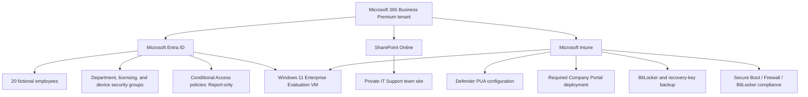
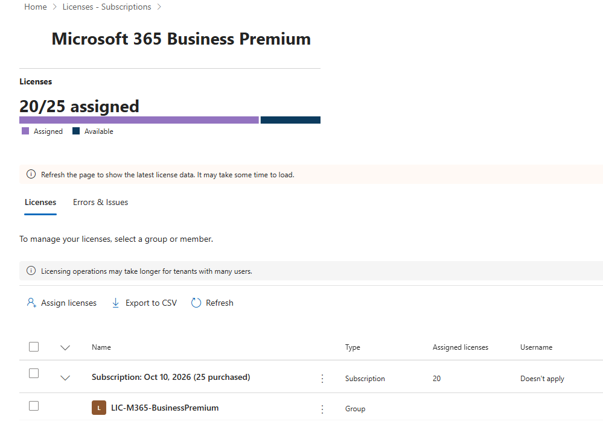
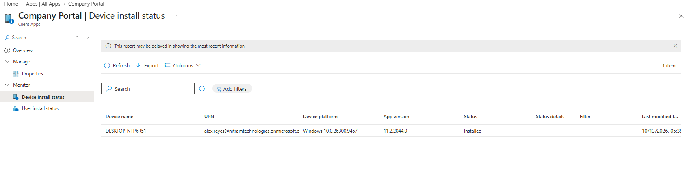

# Nitram Technologies | Secure Microsoft 365 Workplace Lab

**A Microsoft 365 identity, collaboration, and endpoint-management proof of concept for a fictional 20-employee IT services company.**

**Project type:** Independent technical lab | **Environment:** Microsoft 365 Business Premium trial, Windows 11 Enterprise Evaluation, Hyper-V | **Scope:** 20 fictional employees and one managed Windows VM

> **Project status:** Core identity, licensing, SharePoint access control, and Intune endpoint-management tasks were implemented and validated. The three Conditional Access policies were **evaluated in Report-only mode, not enforced**. This is a controlled lab, not a production deployment or completed enterprise migration.

## Executive summary

I built a simulated Microsoft 365 workplace for Nitram Technologies to demonstrate the technical responsibilities involved in supporting a small organization. The work covered user onboarding, scalable license assignment, role delegation, identity-security policy design, private document collaboration, Windows enrollment, application deployment, disk encryption, and device compliance.

The focus was on **measurable results**, not just creating configurations. I tested administrative boundaries, checked employee access, confirmed an application installed from Intune, verified BitLocker protection and recovery-key escrow, and reviewed compliance at the individual-setting level.

## Business requirements and delivered outcomes

| Requirement | Implementation | Verified outcome |
| --- | --- | --- |
| Centralize employee identities | Microsoft Entra ID with 20 fictional users in six departments | One manual account + 19 accounts imported successfully |
| Simplify software licensing | Dedicated `LIC-M365-BusinessPremium` security group | All 20 employees inherited licenses; 20 of 25 trial seats assigned |
| Delegate IT responsibilities safely | Helpdesk, User, Security Reader, and Billing administrator roles | Allowed and restricted administration actions reviewed |
| Design stronger sign-in controls | Passwordless MFA pilot, broad passwordless policy, legacy-client blocking policy | Report-only policy results examined; **no CA enforcement** |
| Restrict department documents | Private, Microsoft 365 group-connected SharePoint team site | IT Support access succeeded; a Sales account was denied |
| Manage a corporate Windows endpoint | Microsoft Entra join and Intune auto-enrollment | Windows 11 Hyper-V VM appeared as Intune-managed |
| Configure endpoint protection | Microsoft Defender PUA protection and BitLocker encryption | PUA setting applied; OS drive 100% encrypted; recovery record backed up |
| Deliver software and assess compliance | Required Company Portal app, Windows compliance policy | App installed; Secure Boot, Firewall, and BitLocker checks passed |

## Solution architecture

**Design choices:** Department groups organize access, a separate group controls licensing, and a device group targets endpoint deployment. Limited administrator roles support least privilege. Conditional Access was evaluated before any rollout; Intune configuration and compliance were validated separately.

## Featured implementation evidence

| Identity and licensing | Device security and compliance |
| --- | --- |
|  |  |

**Intune application deployment:** Company Portal was deployed as a required app to the Windows test VM and reported **Installed**.

**Identity-policy validation:** A Conditional Access report-only event showed **Success**. This proves the policy evaluation result, **not** enforcement.

## Implementation reports

The reports below describe **what was implemented, why the approach was chosen, and what evidence supports the results**. They are case-study documentation, not click-by-click tutorials.

| Report | Focus |
| --- | --- |
| [01. Identity and licensing](docs/01-identity-and-licensing.md) | Employee provisioning, department structure, inherited licensing |
| [02. Delegated administration](docs/02-admin-roles.md) | Role assignments and least-privilege validation |
| [03. Identity security](docs/03-conditional-access.md) | Passwordless MFA policies, legacy authentication scope, report-only results |
| [04. SharePoint collaboration](docs/04-sharepoint.md) | Private team site, membership and access tests, upload simulation |
| [05. Intune endpoint management](docs/05-intune.md) | Windows enrollment, device targeting, Defender, required application |
| [06. BitLocker and compliance](docs/06-bitlocker-and-compliance.md) | Encryption, recovery-key escrow, individual compliance checks |
| [07. Validation and improvements](docs/07-validation-and-lessons.md) | Test matrix, issues resolved, documented limitations |

[Browse the complete evidence catalog](screenshots/README.md).

## Scope and limitations

- **Conditional Access:** All three policies remained in Report-only mode, while Security Defaults remained enabled. No enforced passwordless rollout or legacy-authentication blocking by these policies is claimed.
- **SharePoint:** Private-site access was tested and three sample files were uploaded. Most files were empty or nearly empty; file contents were not validated, so this is not a completed file-server migration.
- **Endpoint scope:** Intune results come from **one** Windows 11 virtual machine, not an organization-wide device rollout.
- **Recovery readiness:** A backup Global Administrator existed, but authentication independence and a live BitLocker recovery exercise were not validated.
- **Data safety:** All employee identities are fictional. No passwords, original bulk-import credential CSV, or BitLocker recovery passwords are published.

## Technologies used

Microsoft Entra ID · Microsoft 365 Admin Center · Microsoft Intune · Microsoft Defender · SharePoint Online · Windows 11 Enterprise Evaluation · Hyper-V · GitHub

---

**Project outcome:** A reproducible small-business proof of concept showing integrated Microsoft 365 administration with clearly recorded successes, unresolved limits, and improvement opportunities.
