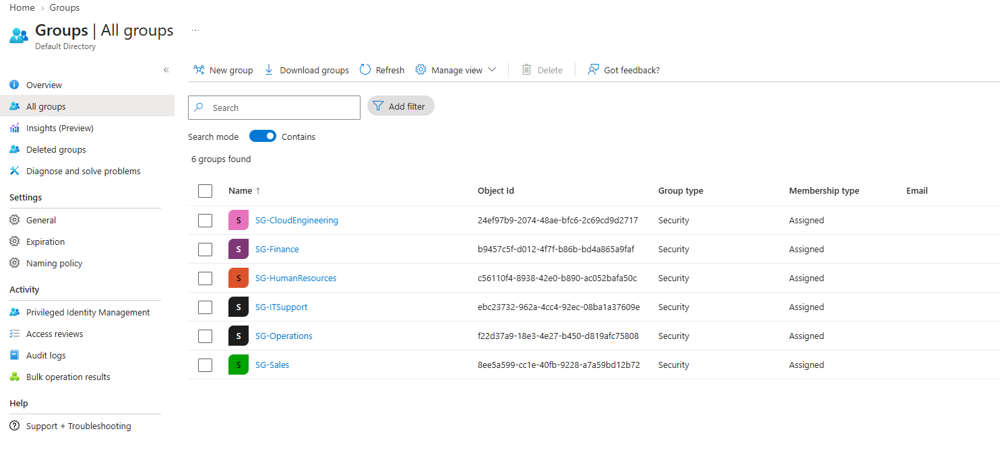

# 01 | Identity provisioning and license management

[← Project overview](../README.md) | [Evidence catalog](../screenshots/README.md)

## Business requirement

Nitram Technologies needed a manageable identity foundation for 20 fictional employees across six functional departments. Onboarding had to be repeatable, and Microsoft 365 licenses should not require manual assignment to each new hire.

## Implemented solution

**Environment:** A Microsoft 365 Business Premium trial with **25 trial licenses** and the `nitramtechnologies.onmicrosoft.com` domain. The original tenant domain was retained as part of the Microsoft 365 environment.

| Component | Implemented configuration | Reason |
| --- | --- | --- |
| User identities | Alex Reyes created manually; 19 additional users bulk imported using Entra ID | Demonstrate individual and scaled provisioning |
| Department organization | Six assigned security groups: IT Support, Cloud Engineering, Sales, HR, Finance, and Operations | Establish clear membership boundaries |
| License allocation | `LIC-M365-BusinessPremium` with all 20 employees as direct members | Separate entitlement management from departmental permissions |
| License assignment | Microsoft 365 Business Premium assigned to the licensing group | Users inherit the product license as their membership changes |

The six departments were sized at IT Support (6), Cloud Engineering (4), Sales (3), Human Resources (2), Finance (2), and Operations (3).

## Results and evidence

**Bulk provisioning:** The Entra bulk operation imported **19 accounts successfully**, resulting in 20 fictional employee accounts including Alex.

**Group structure:** All six department security groups were created. The IT Support group contained six assigned employees.

**License allocation:** All 20 employees received inherited Business Premium assignments through `LIC-M365-BusinessPremium`. The licensing view showed **20 / 25** seats assigned.

## Operational note

The first attempt to assign the license to the group returned an `@odata.bind` error. Retrying the unchanged assignment succeeded. The cause was not established, so this is recorded as a **transient, unconfirmed error**, not a diagnosed service bug.

## Technical decisions

- **Separate groups by purpose:** Department groups represent functional membership; the licensing group controls a product entitlement.
- **Assigned membership for the lab:** Direct membership made validation transparent without introducing dynamic-membership rules.
- **No credentials in the portfolio:** The bulk creation CSV contained temporary passwords and was excluded from the public repository.

**Outcome:** Identity creation and group-based licensing worked for the 20-person simulated organization.

**Additional records:** [First employee](../screenshots/01-entra-id/01-alex-user-profile.png) · [Successful bulk import submission](../screenshots/01-entra-id/03-bulk-import-submission.png) · [IT Support membership](../screenshots/01-entra-id/05-it-support-group-members.png) · [Licensing group](../screenshots/01-entra-id/06-business-premium-license-group.png)
