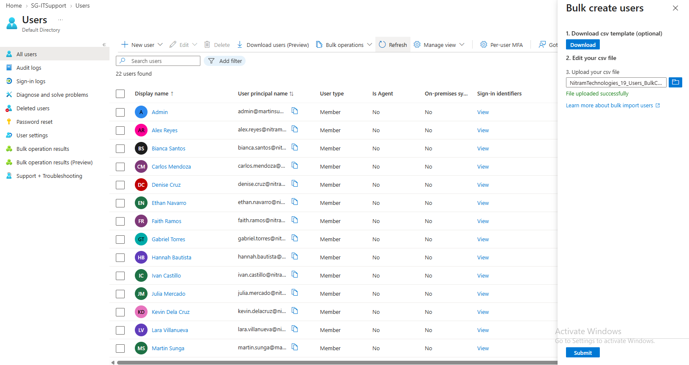

# 01. Identity and Licensing

[← Project overview](../README.md) | [Screenshot catalog](../screenshots/README.md)

## Overview

Created and organized employee accounts in Microsoft Entra ID for Nitram Technologies, a fictional company with 20 employees.

## Implementation

- Created one employee account manually and imported 19 more using CSV bulk provisioning.
- Organized employees into six departmental security groups: IT Support, Cloud Engineering, Sales, Human Resources, Finance, and Operations.
- Created the `LIC-M365-BusinessPremium` security group for group-based licensing, separate from the departmental groups.
- Assigned Microsoft 365 Business Premium licenses through group membership instead of assigning them individually.

## Results

| Validation | Result |
| --- | --- |
| Employee accounts | 20 created (1 manual, 19 bulk imported) |
| Departmental groups | Six groups configured |
| License assignment | All 20 employees received inherited Business Premium licenses |
| License usage | 20 of 25 trial licenses assigned |

## Evidence

**Employee accounts after bulk import**

**Business Premium license assignment**

## Notes

The initial license assignment returned an `@odata.bind` error but succeeded on retry; the underlying cause was not confirmed. No user passwords or bulk-import credential files are included in this repository.
