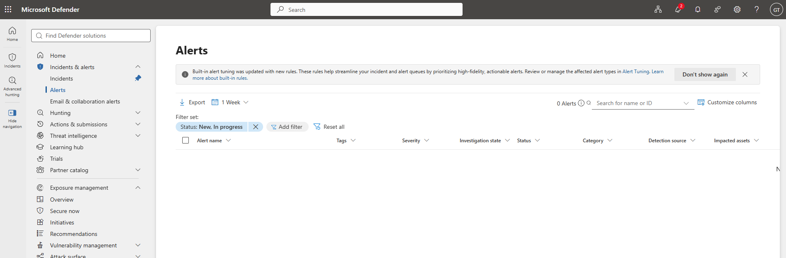

# 02 | Role delegation and least privilege

[← Project overview](../README.md) | [Evidence catalog](../screenshots/README.md)

## Business requirement

A small IT services organization needs administrative responsibility distributed across support, user administration, security review, and billing without granting every employee unrestricted Global Administrator access.

## Implemented access model

| Fictional employee | Microsoft Entra role | Intended responsibility |
| --- | --- | --- |
| Alex Reyes | Helpdesk Administrator | Limited password and helpdesk support |
| Bianca Santos | User Administrator | Employee account administration |
| Gabriel Torres | Security Reader | Review identity and Microsoft Defender security information |
| Queenie Flores | Billing Administrator | Subscription and billing-related administration |

These built-in roles were deliberately separate from **job titles** and **departmental security group membership**. Membership in `SG-ITSupport` does not itself grant directory administrator rights or Windows local administrator access.

## Permission validation

### Allowed operation: Helpdesk Administrator

Alex signed in using his own test identity and opened the password-reset function for a regular employee account.

**Result:** The reset control was available. **No password reset was executed**, so the test proves access to the operation, not a completed recovery workflow.

### Read-only security access: Security Reader

Gabriel accessed Microsoft Entra sign-in information and, once Defender's tenant setup progressed, could open the Microsoft Defender **Alerts** page.

The test also showed that Gabriel could not carry out a normal user's password reset using this role.

## Implementation issue

The Defender portal initially remained on a provisioning/loading screen, and an **Incidents** view returned a permissions message. After the service setup progressed, Gabriel was able to access **Alerts**. This evidence does **not** establish unrestricted read access to every Defender workload, and the permission issue's root cause was not confirmed.

## Result and rationale

The lab demonstrates scoped role assignments and basic positive/negative permission tests. Higher privileges were not added simply to bypass a portal-access issue.

**Additional role evidence:** [Helpdesk Administrator](../screenshots/02-admin-roles/01-helpdesk-admin-role.png) · [User Administrator](../screenshots/02-admin-roles/03-user-admin-role.png) · [Security Reader](../screenshots/02-admin-roles/04-security-reader-role.png) · [Billing Administrator](../screenshots/02-admin-roles/05-billing-admin-role.png)
