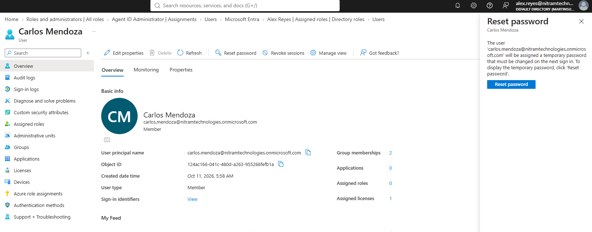
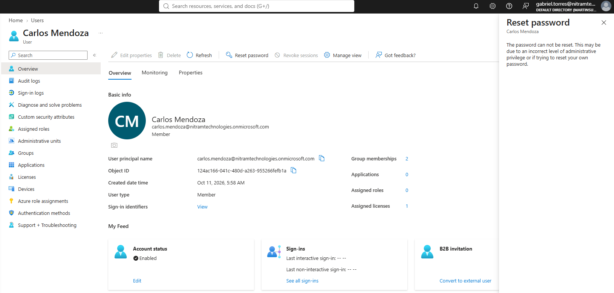

# 02. Delegated Administration

[← Project overview](../README.md) | [Screenshot catalog](../screenshots/README.md)

## Overview

Assigned administrator roles based on employee responsibilities to demonstrate least-privilege access in Microsoft Entra ID.

## Implementation

| Employee | Assigned role |
| --- | --- |
| Alex Reyes | Helpdesk Administrator |
| Bianca Santos | User Administrator |
| Gabriel Torres | Security Reader |
| Queenie Flores | Billing Administrator |

These are directory roles, not permissions automatically granted by departmental security group membership.

## Results

- **Helpdesk Administrator:** Alex could access the password-reset function for a standard user. An actual reset was not performed.
- **Security Reader:** Gabriel could review Entra sign-in information and the Microsoft Defender Alerts page.
- **Access restriction:** Gabriel could not reset a user's password with the Security Reader role.
- **Other roles:** User Administrator and Billing Administrator assignments were confirmed; their full permission sets were not tested.

## Evidence

**Helpdesk Administrator access**

**Security Reader restriction**

## Notes

The Microsoft Defender portal initially showed loading and permission issues. The Alerts page became accessible later, but this does not establish access to every Defender workload.
