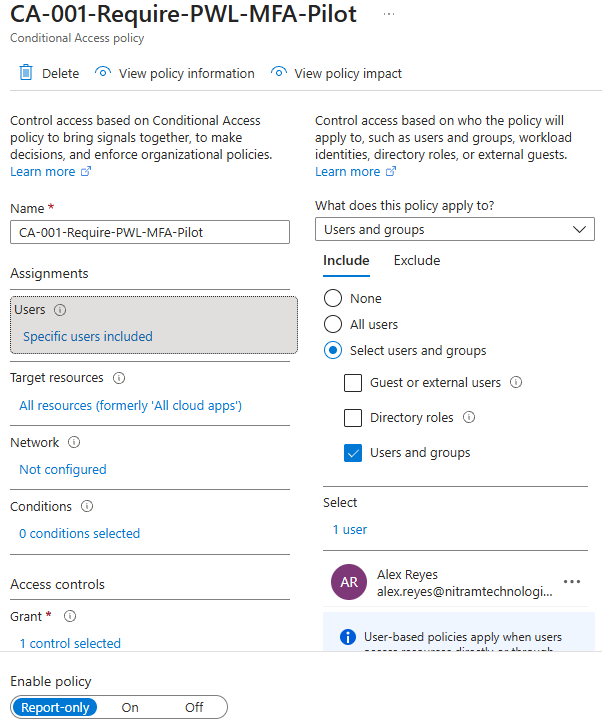
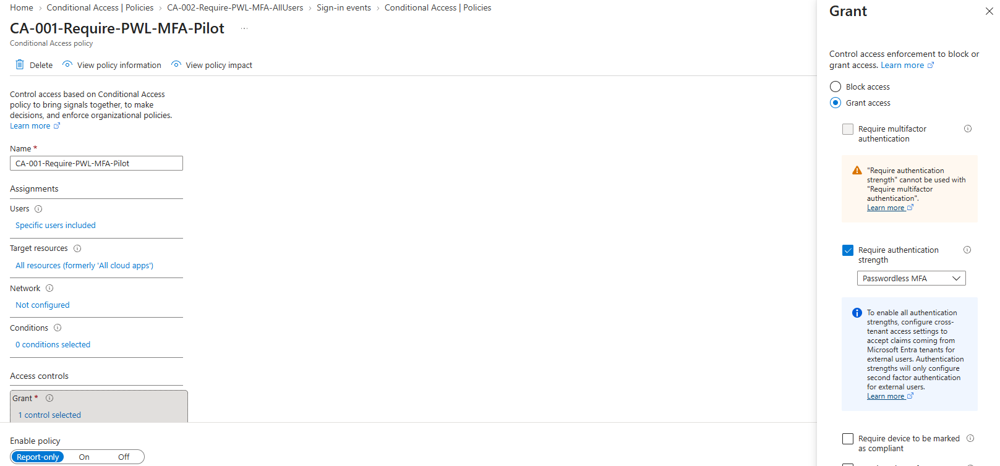
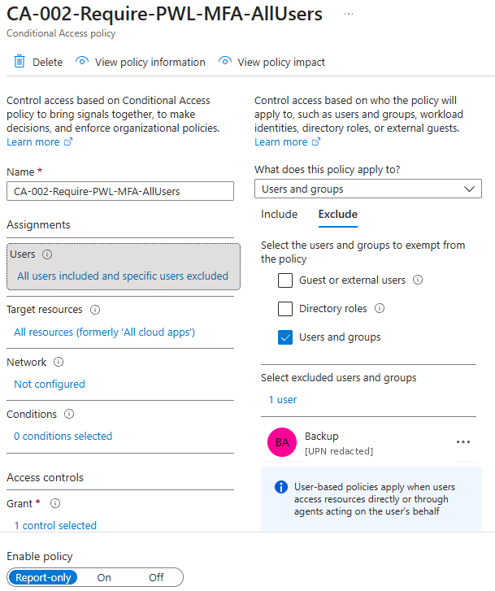
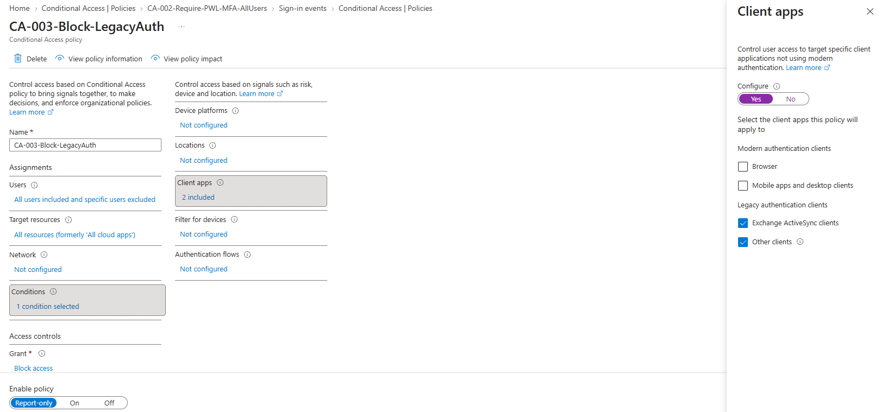
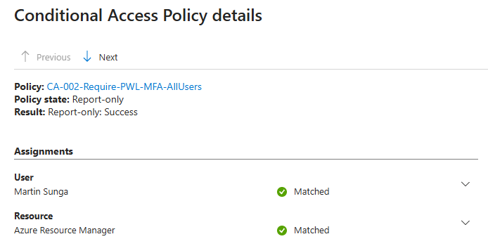

# 03 | Conditional Access design and evaluation

[← Project overview](../README.md) | [Evidence catalog](../screenshots/README.md)

## Business requirement

Nitram Technologies needed a design for stronger sign-in controls and the ability to assess policy impact before disrupting legitimate employee access. The new tenant began with **Microsoft Entra Security Defaults enabled** and no custom Conditional Access policies.

## Policies prepared

| Policy | Coverage and control | Observed state |
| --- | --- | --- |
| `CA-001-Require-PWL-MFA-Pilot` | Alex Reyes; **Passwordless MFA** authentication strength | Report-only |
| `CA-002-Require-PWL-MFA-AllUsers` | All users except the designated backup Global Administrator; **Passwordless MFA** strength | Report-only |
| `CA-003-Block-LegacyAuth` | All users except backup Global Administrator; legacy client app categories; **Block access** grant | Report-only |

The pilot limited the initial testing scope. The broad MFA and legacy-client policies were designed for a potential future transition away from Security Defaults but **were never switched On** in this project.

### Evidence: policy scope and controls

## Pilot observations

Alex's sign-in events were evaluated in Microsoft Entra sign-in logs:

- A **Report-only: Success** event confirmed that the proposed policy conditions and grant requirements would have been met for that event.
- Another event showed **Report-only: User action required**, indicating an additional authentication action would have been needed for a future enforced policy.
- The legacy-client blocking policy did **not** apply to observed modern interactive sign-ins, which is expected for those client conditions.

**Important distinction:** Signing in with Microsoft Authenticator or seeing a Report-only success does **not** mean these Conditional Access policies enforced MFA. Security Defaults and registered authentication methods can affect actual sign-in behavior separately.

## Security and rollout assessment

The backup Global Administrator was excluded from the two broad policies to reduce potential lockout risk. However, **independently secured emergency authentication was not verified** during this lab, and compatible passwordless methods were not confirmed for all 20 employees.

For those reasons, the project stopped at policy configuration and evaluation. It does not claim an enforced passwordless rollout or active blocking of legacy authentication through CA-003.

**Additional evidence:** [All-users passwordless grant](../screenshots/03-conditional-access/04-all-users-passwordless-grant.png) · [Legacy-authentication policy scope](../screenshots/03-conditional-access/05-legacy-auth-policy-exclusion.png)

**Outcome:** Three policy designs were documented and evaluated in Report-only mode, with enforcement readiness explicitly left as future work.
