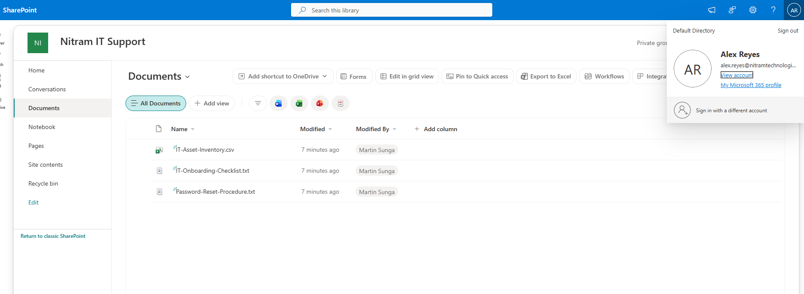
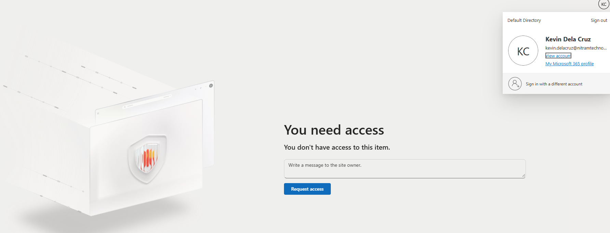

# 04. SharePoint Collaboration

[← Project overview](../README.md) | [Screenshot catalog](../screenshots/README.md)

## Overview

Created a private SharePoint workspace for the IT Support department and tested whether access was restricted to approved members.

## Implementation

- Created the **Nitram IT Support** private SharePoint team site.
- Added six IT Support employees to the site-connected Microsoft 365 Group.
- Uploaded three sample files to the Documents library.
- Used separate employee accounts to test allowed and restricted access.

The SharePoint-connected Microsoft 365 Group is separate from the `SG-ITSupport` Entra security group.

## Results

| Test | Result |
| --- | --- |
| IT Support member (Alex Reyes) | Could open the site and view its documents |
| Sales nonmember (Kevin Dela Cruz) | Received a **You need access** message |
| Sample file upload | Three files appeared in the SharePoint library |

## Evidence

**Authorized employee access**

**Restricted access for a nonmember**

## Notes

The uploaded files were empty or nearly empty, and their contents were not validated after upload. This demonstrates file upload and site permissions, **not a completed data migration**.
