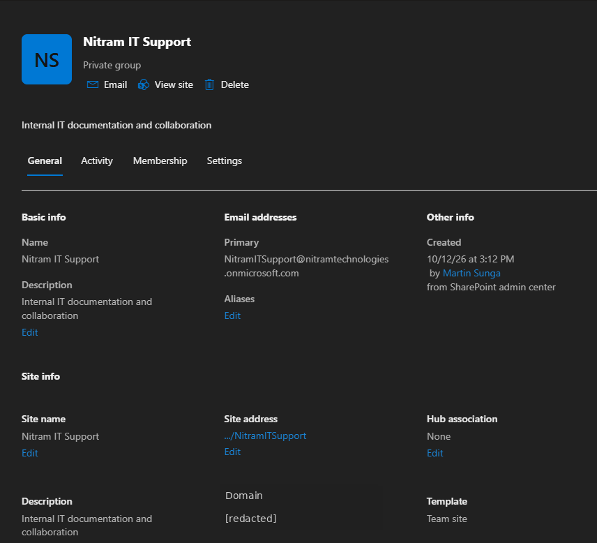
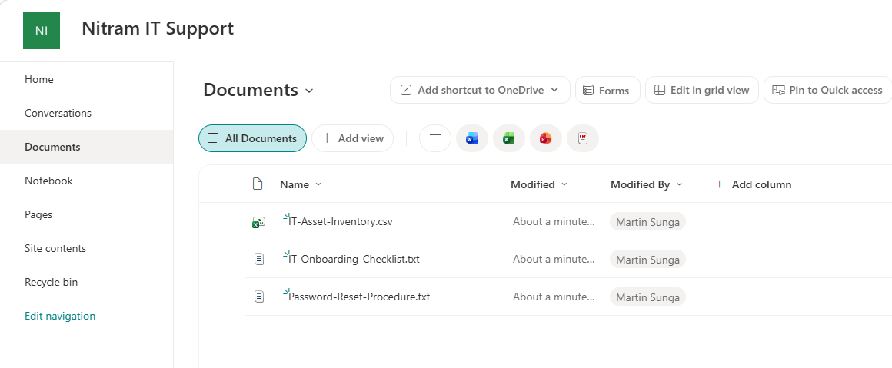

# 04 | SharePoint collaboration and access control

[← Project overview](../README.md) | [Evidence catalog](../screenshots/README.md)

## Business requirement

Provide Nitram Technologies' IT Support department with a shared document workspace while preventing unrelated departments from accessing restricted team content.

## Implemented design

| Component | Configuration | Purpose |
| --- | --- | --- |
| SharePoint site | **Nitram IT Support**, modern Team Site | Shared departmental workspace |
| Privacy | **Private** | Limit collaboration to approved members |
| Microsoft 365 Group | Group connected to the Team Site | Maintain collaboration membership |
| Membership | Six IT Support employee accounts plus administrative ownership | Restrict department access |
| Documents library | Three sample files uploaded | Demonstrate cloud storage and access paths |

The site-connected **Microsoft 365 Group** is separate from the `SG-ITSupport` Entra security group used elsewhere in the lab. Membership was configured for the SharePoint collaboration workspace itself.

## Access-control validation

**Authorized employee:** Alex Reyes, a member of the IT Support team, could open the site and view its Documents library.

**Unauthorized employee:** Kevin Dela Cruz, a Sales employee outside the team site membership, received a **You need access** message when attempting to open the same site.

These are targeted functional tests of private-site permissions rather than a full permissions audit.

## Local-file upload demonstration

Three fictional IT Support files were placed in a local source folder and uploaded to the SharePoint Documents library.

**Scope clarification:** The source set included empty or nearly empty files, and file contents/integrity were not validated after upload. This is a successful **file-upload simulation**, not evidence of a completed file-server migration.

**Additional evidence:** [Site homepage](../screenshots/04-sharepoint/02-team-site-homepage.png) · [Local source folder](../screenshots/04-sharepoint/03-local-source-files.png)

**Outcome:** The private SharePoint workspace was established, and both allowed and denied user-access scenarios were observed. A complete migration would require source assessment, content verification, and a repeatable cutover plan.
