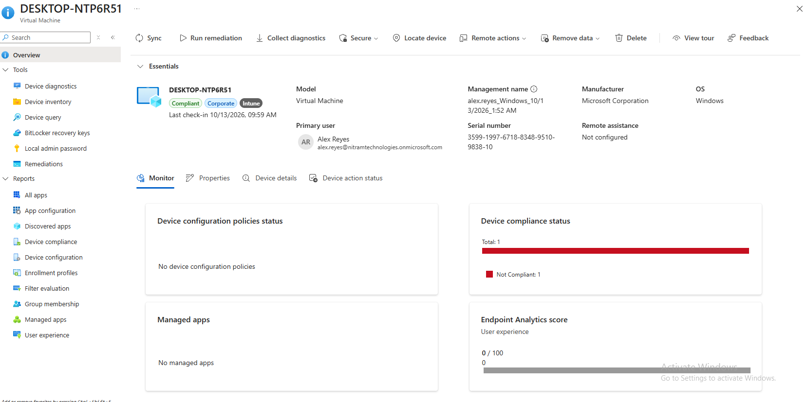
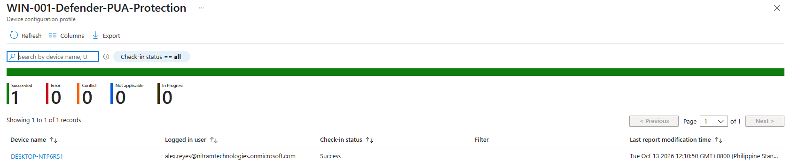
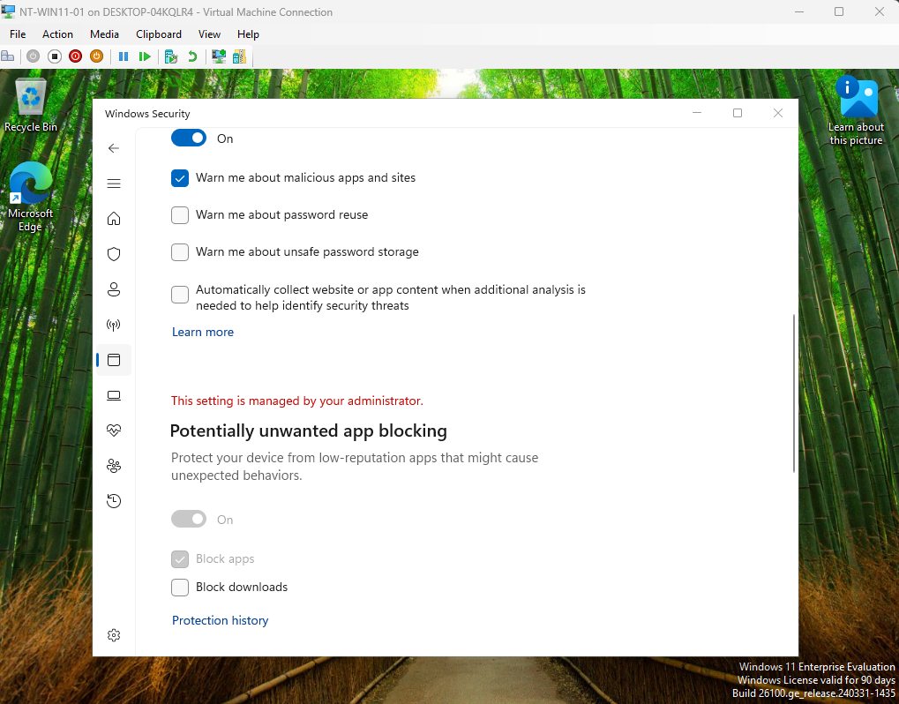
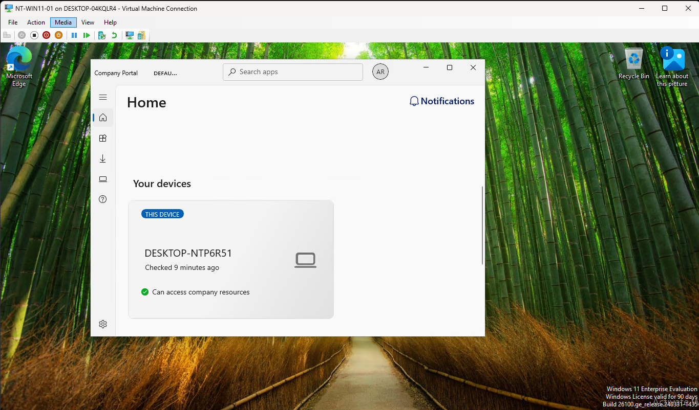

# 05 | Windows endpoint enrollment and deployment

[← Project overview](../README.md) | [Evidence catalog](../screenshots/README.md)

## Business requirement

Demonstrate how a Technical Engineer can onboard a Windows workstation to centralized management, deploy a baseline security setting, and install a required application without manually configuring each device.

## Test endpoint and enrollment design

| Layer | Lab implementation |
| --- | --- |
| Host virtualization | Hyper-V Generation 2 virtual machine, `NT-WIN11-01` |
| Guest OS | Windows 11 Enterprise Evaluation |
| Virtual hardware | 4 GB startup RAM, 2 virtual processors, 80 GB virtual disk, virtual TPM and Secure Boot |
| Organizational identity | Microsoft Entra joined using Alex Reyes |
| Intune enrollment | Automatic enrollment, `MDM user scope = Some`, targeting `SG-ITSupport` |
| Windows device name | `DESKTOP-NTP6R51` |
| Deployment targeting | `SG-ManagedWindows`, an assigned security group containing the **device object** |

MDM enrollment scope defines which users are targeted for **automatic** enrollment; it does not assign Windows local administrator privileges to everyone in `SG-ITSupport`. Device-targeted deployments were isolated to our single managed VM.

## Endpoint protection: Microsoft Defender PUA blocking

The `WIN-001-Defender-PUA-Protection` Settings Catalog policy targeted the managed device group and configured potentially unwanted application (PUA) blocking.

**Validation:** Intune reported **Succeeded** for the VM. Windows Security also showed PUA blocking enabled and controlled by the organization.

## Application deployment: Company Portal

Company Portal was added as a **Microsoft Store app (new)** and assigned as **Required** to `SG-ManagedWindows`, rather than to **All devices**.

**Validation:** The device installation report showed **Installed**, and Company Portal launched inside the VM under Alex's account.

## Technical decisions and limits

- Device assignment was chosen so targeted device settings and required apps were associated with the managed VM rather than individual employee accounts.
- Intune policies were verified in both the admin reporting plane and the Windows UI when available.
- The lab used **one** VM. It did not exercise Windows Autopilot, a fleet rollout, production application packaging, or reassignment to another primary user.

**Additional evidence:** [Device group](../screenshots/05-intune/02-managed-windows-device-group.png) · [PUA policy definition](../screenshots/05-intune/03-defender-policy-configuration.png) · [Required app assignment](../screenshots/05-intune/06-company-portal-required-assignment.png)

**Outcome:** Intune enrollment, centralized endpoint configuration, and required application installation were demonstrated successfully on a managed Windows test device.
