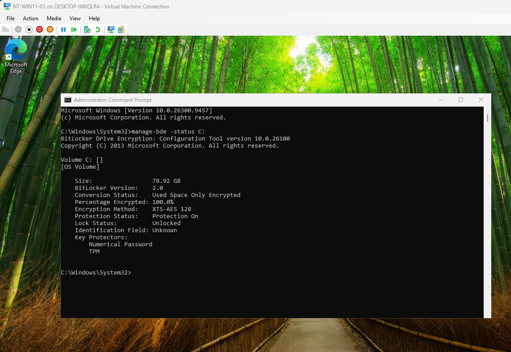
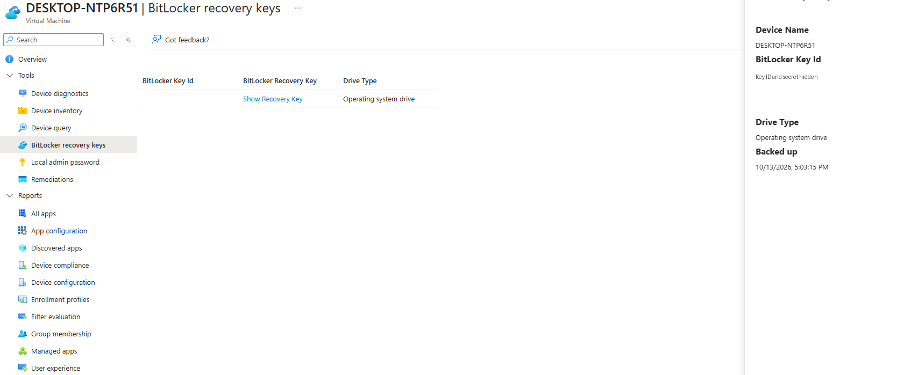
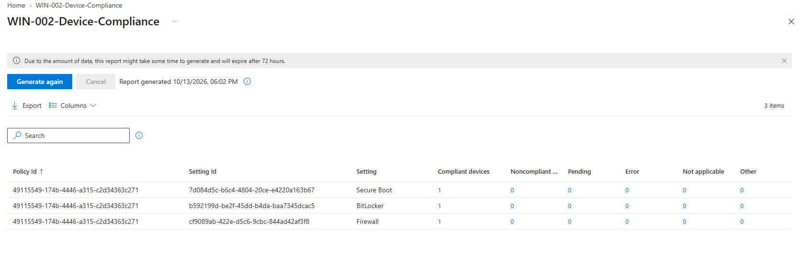

# 06 | Disk encryption and device compliance

[← Project overview](../README.md) | [Evidence catalog](../screenshots/README.md)

## Business requirement

Protect data at rest on a company-managed Windows endpoint, retain recovery information for IT support, and evaluate the machine against a defined security baseline.

## Encryption implementation

The Intune policy `WIN-003-BitLocker-Encryption` was assigned to `SG-ManagedWindows`. It enabled device encryption using the Windows virtual TPM and configured silent encryption settings for the test VM.

**Observed encryption state on `C:`**

| Field | Verified result |
| --- | --- |
| Conversion status | Used Space Only Encrypted |
| Encrypted percentage | **100.0%** |
| Encryption method | XTS-AES 128 |
| Protection status | **Protection On** |
| Key protectors | TPM and Numerical Password |
| Recovery record | Operating system drive recovery record visible in Intune |

The displayed recovery record confirms the backup **exists**. The actual 48-digit password is intentionally absent from this repository.

## Encryption issue resolved

Windows initially refused the BitLocker setup because the **bootable Windows installation ISO remained attached** to the Hyper-V virtual DVD drive. Removing that ISO and restarting the VM cleared the obstacle. This did not require resetting the virtual TPM or exposing recovery information.

## Compliance evaluation

`WIN-002-Device-Compliance` checked three separate device-health/security requirements:

| Requirement | Configured condition | Verified report |
| --- | --- | --- |
| Secure Boot | Required | 1 compliant, 0 noncompliant |
| Windows Firewall | Required | 1 compliant, 0 noncompliant |
| BitLocker | Required | 1 compliant, 0 noncompliant |

### Why two policy types were necessary

- **Encryption/configuration policy:** Applies BitLocker settings and initiates encryption.
- **Compliance policy:** Reports whether the device actually meets the security requirement. It does not encrypt the drive on its own.

Compliance status by itself **did not block access** to Microsoft 365 resources in this lab because no enforced Conditional Access policy requiring compliant devices was configured.

## Additional evidence and limitations

[BitLocker policy](../screenshots/05-intune/09-bitlocker-policy.png) · [Successful Intune configuration status](../screenshots/05-intune/10-device-config-success.png)

The lab verified a recovery-key record but did not intentionally trigger a BitLocker recovery screen or simulate physical loss of the VM host. The single-VM result should not be generalized to every Windows device type.

**Outcome:** BitLocker encryption reached 100%, recovery information was backed up, and all three targeted compliance settings reported success.
